# SyncVitals

SyncVitals is a health and wellness tracking app with a React web client, Django
REST API, and Android companion app. It brings together personal metrics,
workouts, diet, recovery, stretching and posture, AI suggestions, subscription
settings, and Health Connect sync.

This is an actively developed project with a live presentation-staging
environment. The production architecture below is a future recommendation.

## What you can track

- **Health metrics** — record values, review history and trends, and explore
  sleep and activity analytics.
- **Workouts** — log sets, reuse routines, browse your training calendar, and
  follow exercise progress and goals.
- **Daily habits** — check off diet, recovery, and stretching and posture
  activities.
- **AI suggestions** — request tracker-based suggestions and revisit saved
  reviews using a personal NVIDIA API key and explicit consent to share a
  tracker summary.
- **Android sync** — import supported Health Connect records through the
  companion app.

Subscription settings include Stripe Checkout and the billing portal; staging
uses Stripe test mode.

<details>
<summary>Show SyncVitals system context</summary>

<p align="center">
  <a href="docs/screenshots/readme/longevity-system-context.svg">
    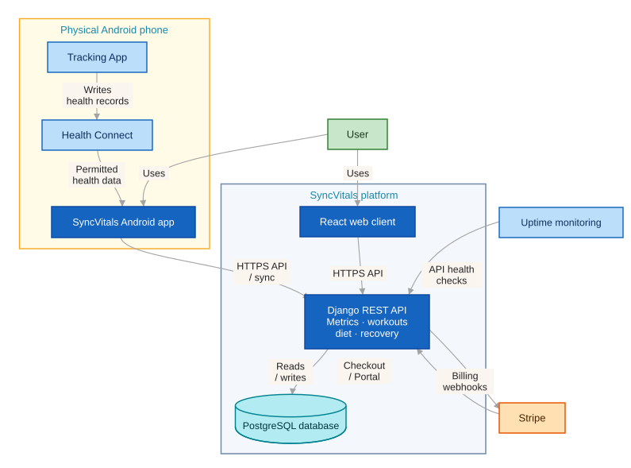
  </a>
</p>
</details>

## Product preview

Mobile previews — click any image to open the full-resolution screenshot.
Most captures are from the local app; the AI Insights image is the supplied capture.

<p><a href="https://staging.syncvitals.space">Open the staging app</a> (sign-in required).</p>

<p align="center"><strong>Dashboard · Steps · Workouts</strong></p>

<p align="center">
  <a href="docs/screenshots/readme/dashboard.jpg">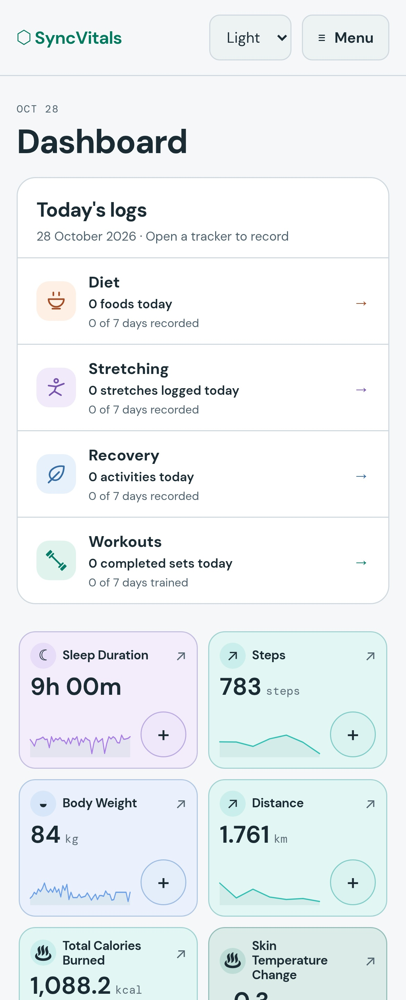</a>
  &nbsp;&nbsp;&nbsp;&nbsp;&nbsp;&nbsp;
  <a href="docs/screenshots/readme/steps.jpg">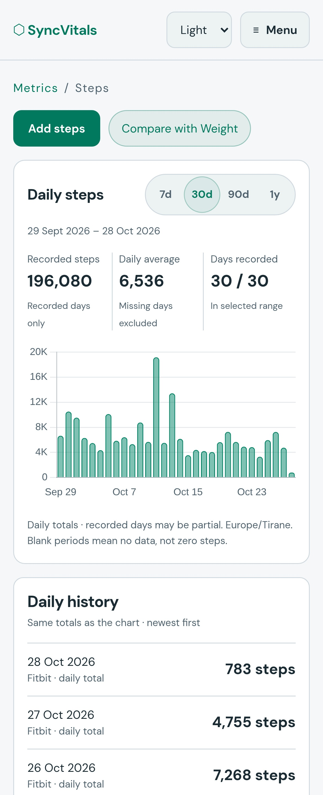</a>
  &nbsp;&nbsp;&nbsp;&nbsp;&nbsp;&nbsp;
  <a href="docs/screenshots/readme/workouts.jpg">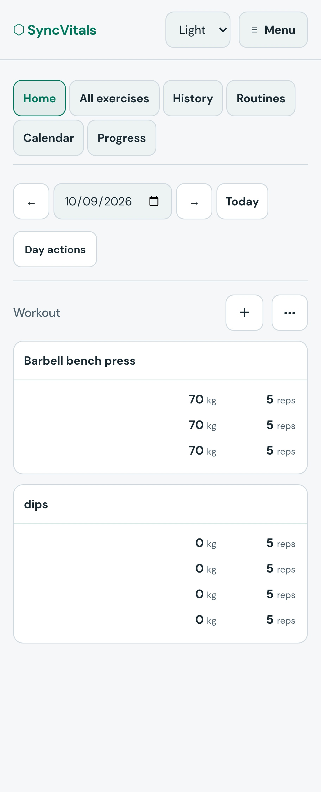</a>
</p>

<details>
<summary>More previews: Diet, Recovery, Stretching &amp; Posture, and AI Insights</summary>

<p align="center"><strong>Diet · Recovery</strong></p>

<p align="center">
  <a href="docs/screenshots/readme/diet.jpg">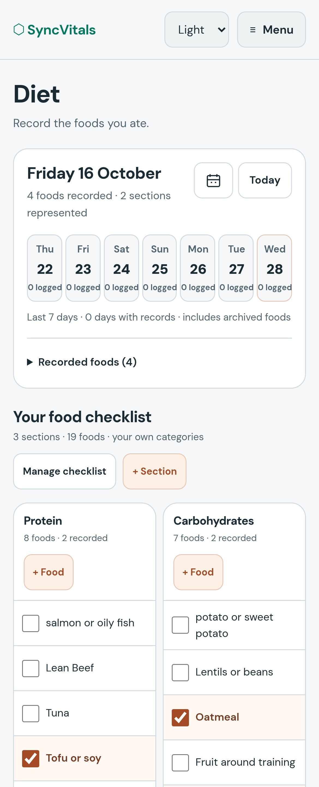</a>
  &nbsp;&nbsp;&nbsp;&nbsp;&nbsp;&nbsp;
  <a href="docs/screenshots/readme/recovery.jpg">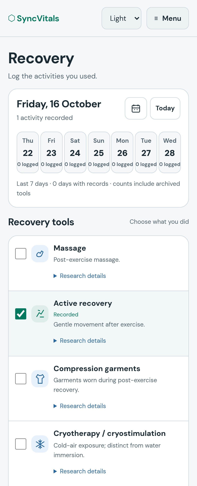</a>
</p>

<br>

<p align="center"><strong>Stretching &amp; Posture · AI Insights</strong></p>

<p align="center">
  <a href="docs/screenshots/readme/stretching.jpg">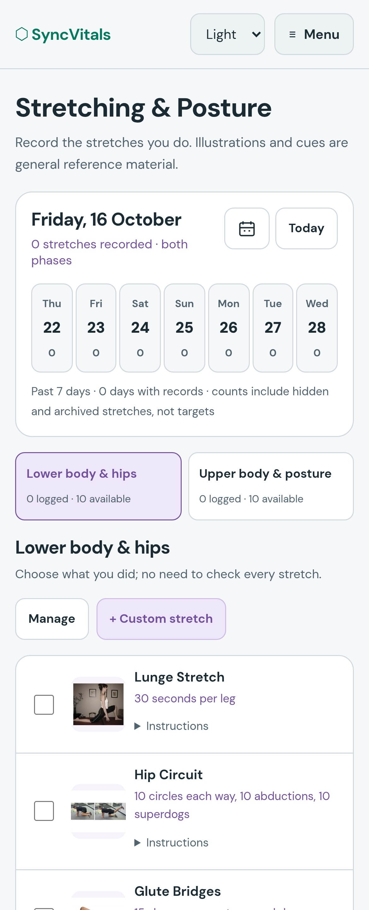</a>
  &nbsp;&nbsp;&nbsp;&nbsp;&nbsp;&nbsp;
  <a href="docs/screenshots/readme/ai-insights.png">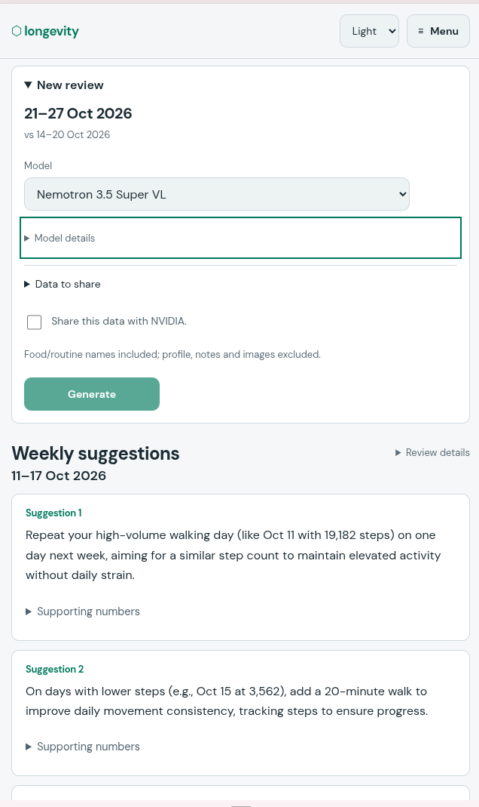</a>
</p>
</details>

## Architecture

### Local development

<details>
<summary>Show local development architecture</summary>

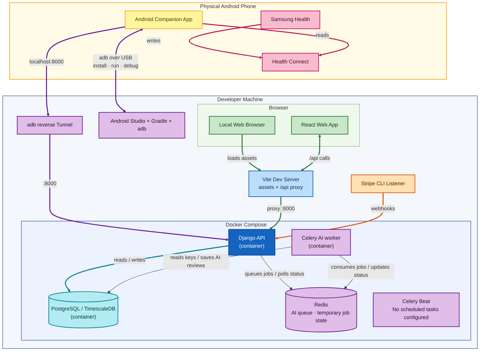
</details>

### Current AWS staging

The [verified V020 deployment model](reference_docs/knowledge/diagrams/current_aws/v020-ai-worker-live.dsl)
is the current staging architecture source. It includes private Redis, a Celery
worker for asynchronous AI suggestions, and the external NVIDIA inference API.
See the
[deployment guide](reference_docs/knowledge/23-production-deployment.md)
for the current runtime and its limits.

<details>
<summary>Show current AWS staging architecture</summary>

#### Request and data path

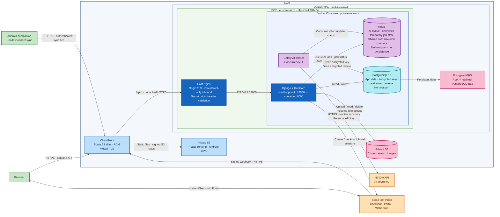

#### Host operations and supporting services

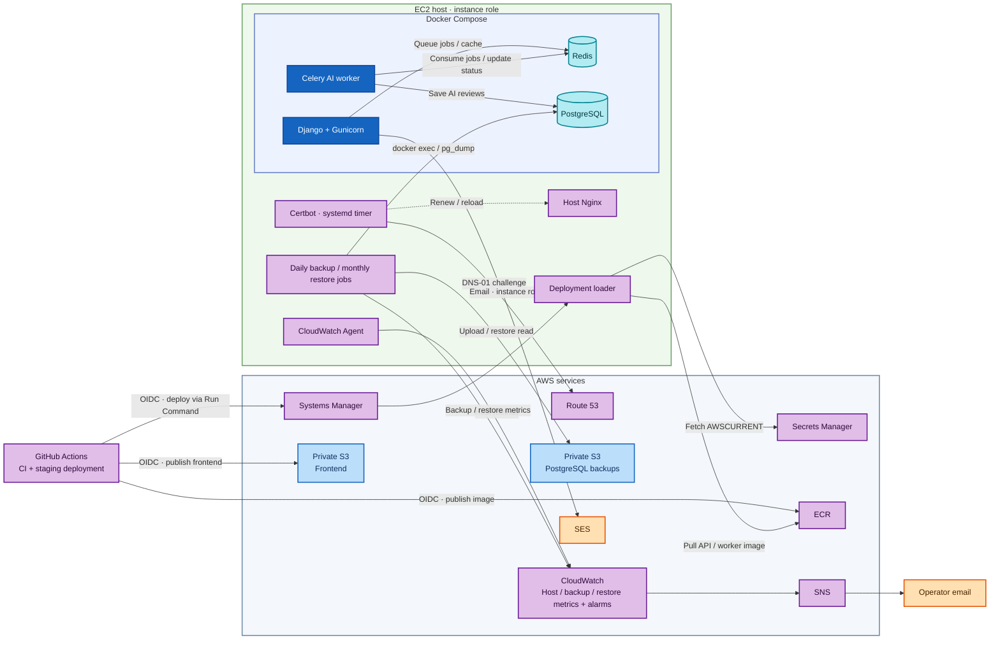
</details>

### Future recommended production

<details>
<summary>Show future recommended production architecture</summary>

#### Request path and horizontal application capacity

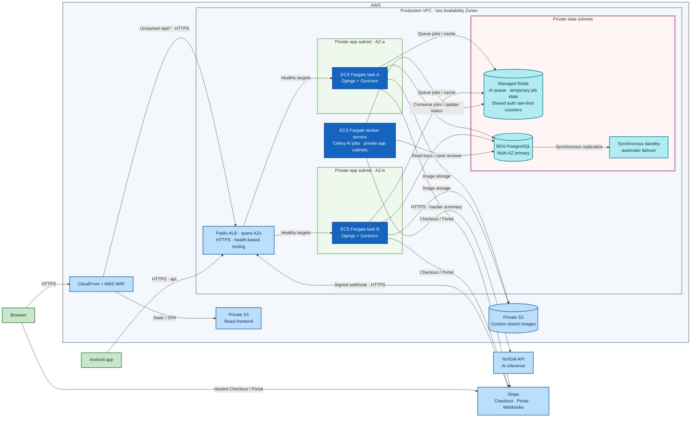

#### Deployment, private egress, and operations

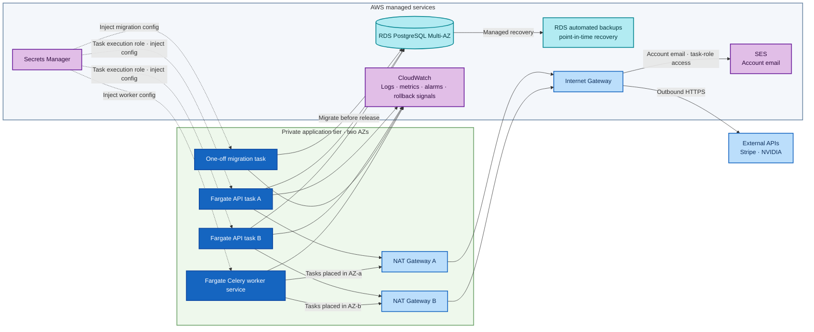
</details>

This is a future recommendation, not deployed infrastructure or a current
provisioning plan. Two API tasks across AZs provide horizontal application
capacity and task/AZ resilience; the RDS standby provides failover, not read
scaling. Autoscaling policies and database read scaling still need design.
Redis availability, durability, and capacity, plus worker count and concurrency,
still need sizing and cost review. Celery Beat is omitted until scheduled jobs
are needed. The [canonical C4 model](reference_docs/knowledge/diagrams/longevity-architecture.dsl)
contains the full production deployment view and security boundaries.

## Run locally

Prerequisites: Docker Engine with Compose, `uv`, Node.js/npm, and (for Android
development) Android Studio with the Android SDK.

Start the backend from one terminal:

```bash
cd backend
cp .env.example .env
# Replace the example-only secret and encryption values in .env.
docker compose up --build
```

See the [development setup guide](reference_docs/knowledge/18-development-environment-setup.md)
for valid local key formats and environment-variable details.

Start the frontend from another terminal:

```bash
cd frontend
npm ci
npm run dev
```

Open the local URL printed by Vite. The frontend proxies `/api` requests to the
backend on port `8000`. Keep `.env` local; never use these development settings
for a deployed environment.

## Checks

```bash
cd backend
docker compose exec web uv run pytest tests
```

```bash
cd frontend
npm ci
npm test
npm run lint
npm run build
```

For Android unit tests, run `./gradlew --no-daemon testDebugUnitTest` from
`android/`. The [development setup guide](reference_docs/knowledge/18-development-environment-setup.md)
also covers device setup; the [frontend README](frontend/README.md) describes
browser end-to-end tests.

## Repository map

- `backend/` — Django REST API, database models, migrations, and backend tests.
- `frontend/` — React + TypeScript app, browser tests, and static deployment.
- `android/` — Kotlin/Jetpack Compose companion app and Health Connect sync.
- `reference_docs/` — project decisions, operations guides, and architecture
  source diagrams.
- `.github/workflows/` — CI and staging deployment workflows.

## Staging

The presentation environment is available at [staging.syncvitals.space](https://staging.syncvitals.space).

